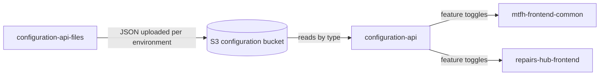

# Configuration API

The Configuration API is the London Borough of Hackney (LBH) **MTFH** service that serves **per-application
configuration and feature toggles**. Each application's configuration is stored as a JSON document in S3,
keyed by the configuration type, and this API returns the requested types to the calling application.

Note that most applications have alternative ways to manage their configuration and feature toggles instead of / in addition to this API - primarily with SSM parameters that feed into environment variables.

It is a read-only, S3-backed API: it never creates, updates or deletes configuration documents.

## Tech stack

| Area | Technology |
| --- | --- |
| Runtime | **.NET 10** (`net10.0`), ASP.NET Core Web API |
| Hosting | **AWS Lambda** (`dotnet10` managed runtime) via `Amazon.Lambda.AspNetCoreServer`, in AWS region `eu-west-2` |
| API layer | Amazon **API Gateway** (`ANY /{proxy+}`) behind a request authorizer and the `Platform_APIs_Web_ACL` WAF |
| Datastore | **Amazon S3** (`AWSSDK.S3`) — one JSON object per configuration type |
| Infrastructure | **Terraform** per environment under [`terraform/`](terraform) — S3 bucket, the SSM bucket-name parameter, and the CloudWatch dashboard/alarms |
| Deployment | **Serverless Framework** ([`ConfigurationApi/serverless.yml`](ConfigurationApi/serverless.yml)) driven by **CircleCI** |
| Observability | **AWS X-Ray** tracing, `Hackney.Core.Logging` structured logging |
| API docs | **Swashbuckle** (Swagger/OpenAPI), one document per API version |
| Cross-cutting | `Hackney.Core.*` packages (JWT, logging, middleware), FluentValidation for request validation, MVC API versioning (URL segment reader), `System.Text.Json` with web defaults (camelCase) plus `JsonStringEnumConverter` |
| Testing | NUnit **and** xUnit (both genuinely in use), FluentAssertions, Moq, AutoFixture, Bogus, `coverlet.collector` |

## Endpoints

Versioning uses `UrlSegmentApiVersionReader` with `DefaultApiVersion = 1.0` and
`AssumeDefaultVersionWhenUnspecified = true`. Only v1 exists.

| Verb | Route | Request (model) | Response (model) | Summary |
| --- | --- | --- | --- | --- |
| GET | `/api/v1/configuration` | `string[] types` — query: the parameter is repeated once per requested type (`?types=First&types=Second`) | `200 OK` → `List<ApiConfiguration>`; keys that do not exist in S3 are silently omitted. Also declares `500`. | Reads each requested configuration type from S3 (the object key **is** the type name) and returns the deserialised documents. |
| GET | `/api/v1/healthcheck/ping` | — | `200 OK` → `{ "success": true }` | Unversioned liveness/readiness probe; carries no `[ApiVersion]`, so it is absent from the Swagger documents, and does not read S3. |
| GET | `/swagger` | — | OpenAPI document / Swagger UI | Interactive API documentation with one document per API version. |

An `ApiConfiguration` contains `Type`, `Configuration` (a dictionary of settings) and `FeatureToggles`
(a dictionary of toggle names to enabled/disabled).

All endpoints sit behind the API Gateway request authorizer and API key.

## Related repositories

This service is one part of the configuration and feature-toggling capability. The configuration documents
themselves live in a separate repository, and the consuming applications read their toggles from here.

| Repository | Summary |
| --- | --- |
| [configuration-api](https://github.com/LBHackney-IT/configuration-api) | **Serves the configuration.** This repository — a read-only HTTP API over the JSON configuration documents in S3. |
| [configuration-api-files](https://github.com/LBHackney-IT/configuration-api-files) | **Stores the configuration.** The per-environment (`development`, `staging`, `production`) JSON files for the MMH feature toggles, which are uploaded to the bucket this API reads. |
| [mtfh-frontend-common](https://github.com/LBHackney-IT/mtfh-frontend-common) | **Consumes the configuration.** Shared frontend library used by the MTFH micro-frontends; fetches its feature toggles from `GET /api/v1/configuration?types=MMH`. |
| [repairs-hub-frontend](https://github.com/LBHackney-IT/repairs-hub-frontend) | **Consumes the configuration.** The Repairs Hub frontend, which reads its feature toggles from the same endpoint. |

## Data sources and external dependencies

| Source | Summary |
| --- | --- |
| S3 bucket `configuration-api-configurations-{development\|staging\|production\|pre-production}` | The only data store, provisioned in [`terraform/`](terraform). The bucket name is read from `CONFIGURATION_S3_BUCKETNAME`. |
| S3 object layout | One JSON object per configuration type — the object **key is the requested configuration type**, so `?types=X` reads object `X`. |
| S3 IAM | `s3:GetObject` and `s3:ListBucket` on the bucket and `bucket/*`. Pre-production additionally enables SSE, versioning, public-access-block and a bucket policy. |
| Local S3 (LocalStack) | `localstack/localstack` (service `s3`, port 4566) from [`docker-compose.yml`](docker-compose.yml). Tests point at it with `CONFIGURATION_S3_URL` (default `http://localhost:4566`) and bucket `configuration-api-configurations`, using path-style addressing and dummy credentials. |
| Amazon API Gateway | Fronts the Lambda: `ANY /{proxy+}` and `GET /swagger/{proxy+}`, behind the request authorizer and the `Platform_APIs_Web_ACL` WAF. |
| AWS X-Ray | Tracing of inbound requests and AWS SDK calls; the Lambda role has `AWSXRayDaemonWriteAccess`. |
| AWS SSM Parameter Store | `/configuration-api/{stage}/bucket-name` supplies the bucket name; `/housing-tl/{stage}/aspnetcore-environment` supplies the Lambda's `ASPNETCORE_ENVIRONMENT`. |
| AWS region | `eu-west-2` throughout. |
| Database | **None.** There is no DynamoDB or SQL database. The `DynamoDb` settings in `appsettings*.json`, `DynamoDb_LocalMode` in the test Dockerfile, `ConfigurationApi.Tests/ConnectionString.cs` and [`database/`](database) (`schema.sql` with an `example_table`, a `postgres:12` Dockerfile, `database.env`) are stale template leftovers and are not used by the application. |

## Contributing

Build, run, test and deployment instructions live in [CONTRIBUTION.md](CONTRIBUTION.md).

## Contacts

**Housing product team** — [mmh-project-team@hackney.gov.uk](mailto:mmh-project-team@hackney.gov.uk)
